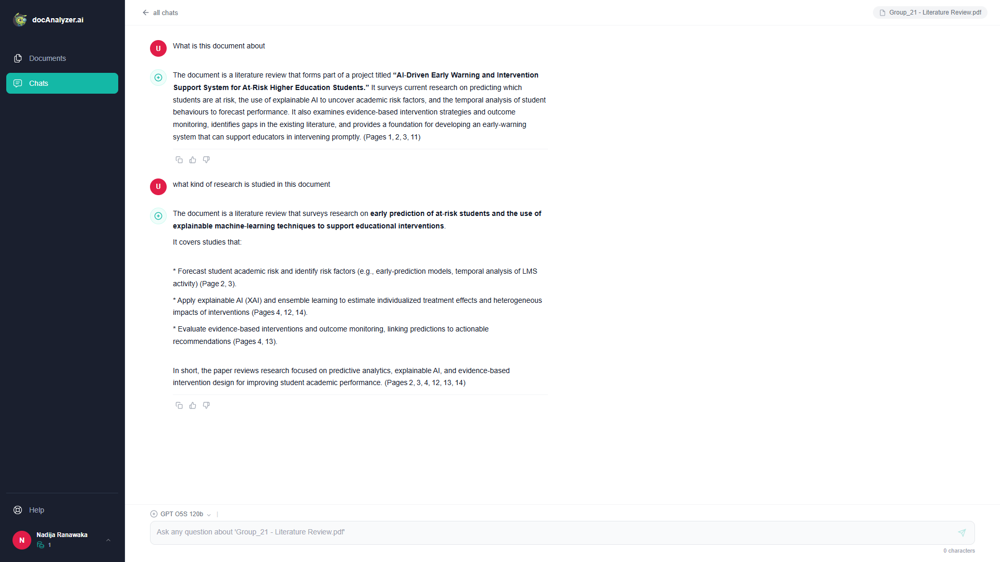
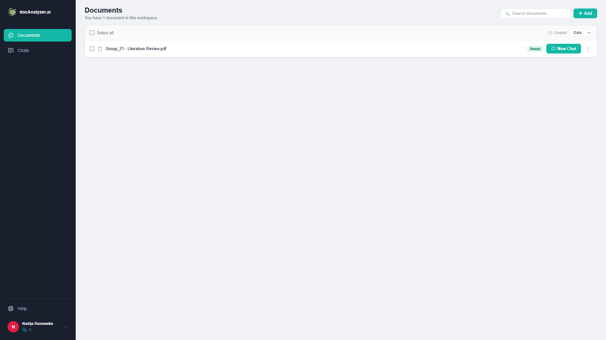
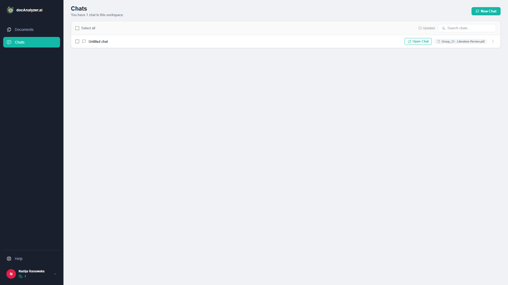
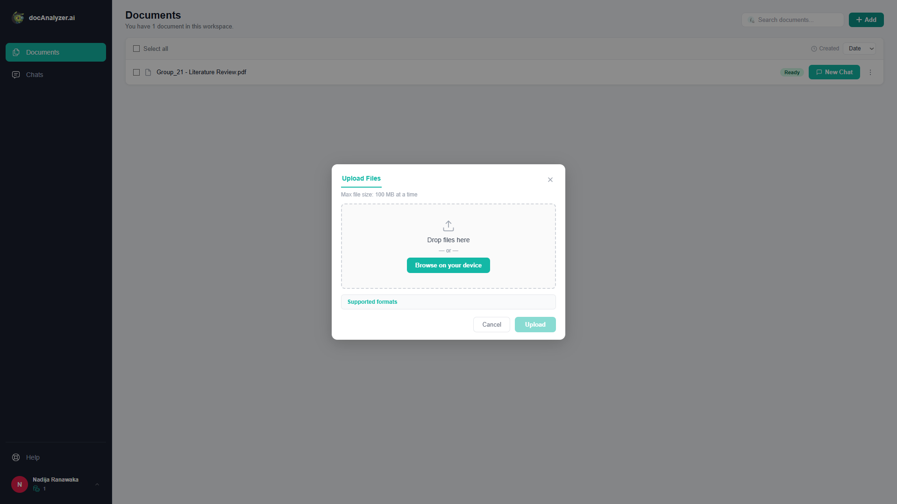
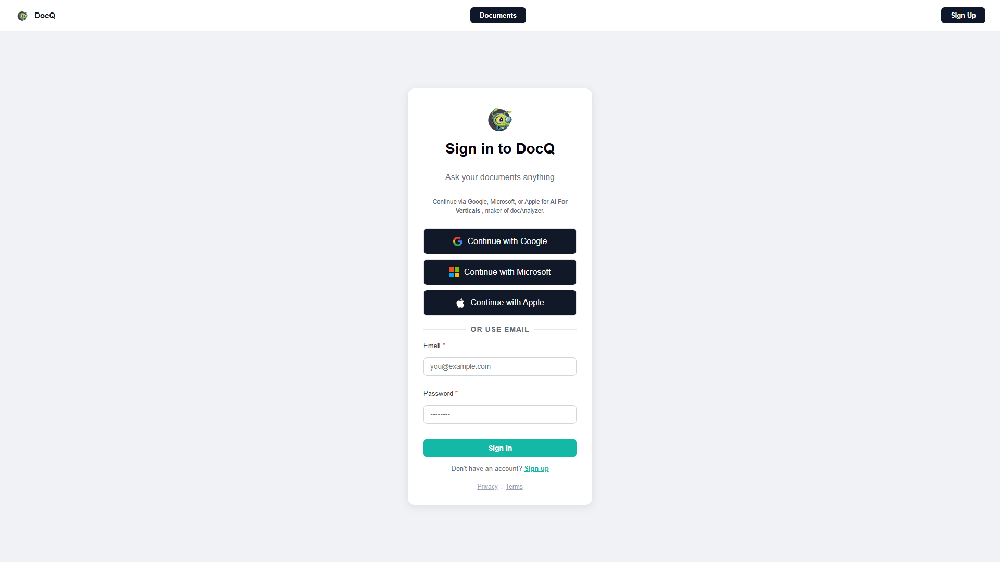
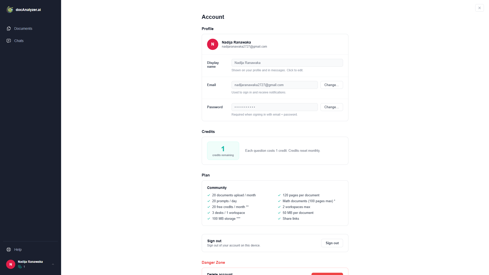

# DOCQ — AI-Powered Document Assistant

## Turn Your Documents Into an Interactive Knowledge Base

DOCQ is an AI-powered document assistant that transforms static PDF files into interactive, searchable knowledge through Retrieval-Augmented Generation (RAG).

Upload documents, ask questions about their contents, and receive contextual AI-generated responses through a conversational interface.

**Your documents. Your knowledge. One conversation away.**


---

## Table of Contents

- [Overview](#overview)
- [Screenshots](#screenshots)
- [Key Features](#key-features)
- [How DOCQ Works](#how-docq-works)
- [System Architecture](#system-architecture)
- [Technology Stack](#technology-stack)
- [Project Structure](#project-structure)
- [Running Locally](#running-locally)
- [AI Usage and Credit System](#ai-usage-and-credit-system)
- [Limitations](#limitations)
- [Future Enhancements](#future-enhancements)
- [Our Team](#our-team)
- [Project Status](#project-status)

---

## Overview

DOCQ is designed to make working with documents more interactive and efficient.

Instead of manually searching through lengthy documents, users can upload their PDF files and interact with their contents using natural language.

DOCQ uses **Retrieval-Augmented Generation (RAG)** to retrieve relevant information from uploaded documents and provide it as context to a language model before generating a response.

This allows users to explore information from their own documents rather than relying solely on general-purpose AI knowledge.

## Screenshots

### 1. AI Chat Interface

The main conversational interface for asking questions and interacting with uploaded documents.



### 2. Document Management

View and access documents uploaded to the user's document library.



### 3. Conversation History

Access previous conversations and continue working with earlier discussions.



### 4. Document Upload

Upload PDF documents to make their contents available for AI-powered retrieval.



### 5. User Registration

Create an account to access the DOCQ platform.



### 6. User Profile

View account information and monitor remaining AI usage credits.



---

## Key Features

| Feature | Description |
|---|---|
| **PDF Document Upload** | Upload PDF documents and process their contents for retrieval. |
| **Document-Based Question Answering** | Ask questions and receive AI-generated answers using retrieved document context. |
| **Retrieval-Augmented Generation** | Retrieve relevant document chunks and provide them as context to the language model. |
| **Semantic Search** | Use vector embeddings to identify document content relevant to user questions. |
| **AI-Powered Responses** | Generate contextual responses using Groq-hosted language models. |
| **Conversation Management** | Create, access, and revisit previous conversations. |
| **Document Library** | View and manage uploaded documents. |
| **User Authentication** | Register and access a personal DOCQ account. |
| **Credit-Based Usage** | Calculate credit deductions based on language-model token consumption. |
| **Token Usage Tracking** | Monitor prompt, completion, and total token usage. |

---

## How DOCQ Works

DOCQ follows a Retrieval-Augmented Generation workflow consisting of two main processes.

### Document Processing and Indexing

1. **Document Upload:** The user uploads a PDF document.
2. **Text Extraction:** Text is extracted from the uploaded document.
3. **Text Chunking:** Extracted content is divided into smaller, manageable chunks.
4. **Embedding Generation:** Sentence Transformers converts text chunks into vector embeddings.
5. **Vector Storage:** Generated embeddings are stored in ChromaDB for similarity-based retrieval.

### Question Answering

6. **Question Processing:** The user's question is converted into a vector embedding.
7. **Similarity Search:** ChromaDB retrieves document chunks relevant to the question.
8. **Context Construction:** Retrieved chunks are assembled into context for the language model.
9. **Response Generation:** The language model generates an answer using the retrieved document context.
10. **Usage Calculation:** Token usage is returned and used to calculate credits deducted from the user's account.

---

## System Architecture

DOCQ is structured around three main application layers that work together to deliver its document-assistant functionality.

| Component | Responsibility |
|---|---|
| **React Frontend** | User interface, authentication, document management, and conversations. |
| **Main FastAPI Backend** | Application APIs, chat management, database operations, and credit management. |
| **AI/RAG FastAPI Backend** | Document processing, embedding generation, vector retrieval, and AI response generation. |

---

## Technology Stack

### Frontend
- React
- JavaScript

### Backend
- Python
- FastAPI

### AI and Retrieval
- Retrieval-Augmented Generation (RAG)
- Sentence Transformers
- `all-MiniLM-L6-v2`
- ChromaDB
- Groq API
- `openai/gpt-oss-20b`

### Database and Storage
- Supabase

---

## Project Structure

```text
DocQ/
│
├── docq-frontend/
│   └── React application
│
├── docq-backend/
│   └── Main FastAPI backend
│
├── docq_ai/
│   ├── api/
│   │   └── main.py
│   ├── app/
│   ├── data/
│   ├── logs/
│   ├── model/
│   ├── services/
│   ├── vector/
│   └── requirements.txt
│
└── docs/
    ├── chat_interface.png
    ├── documents.png
    ├── chat.png
    ├── upload.png
    ├── signup.png
    └── profile.png
```

---

## Running Locally

DOCQ consists of three separately running applications:

- React frontend
- Main FastAPI backend
- AI/RAG FastAPI backend

### Prerequisites

Make sure you have the following installed:

- Python
- Node.js and npm
- Git
- Supabase project credentials
- Groq API key

### 1. Clone the Repository

```bash
git clone https://github.com/nadijaranawaka/DocQ.git
cd DocQ
```

### 2. Start the AI/RAG Backend

Navigate to the AI backend:

```powershell
cd docq_ai
```

Create and activate a virtual environment:

```powershell
python -m venv .venv
.\.venv\Scripts\Activate.ps1
```

Install dependencies:

```powershell
pip install -r requirements.txt
```

Configure the required environment variables using your local environment configuration.

Start the AI/RAG service from the `docq_ai` directory:

```powershell
uvicorn api.main:app --reload --port 8001
```

- AI/RAG API: `http://127.0.0.1:8001`
- API documentation: `http://127.0.0.1:8001/docs`

### 3. Start the Main Backend

Open a separate terminal and navigate to the main backend:

```powershell
cd docq-backend
```

Create and activate its virtual environment, install its dependencies, and configure the required environment variables.

Start the service:

```powershell
uvicorn main:app --reload --port 8000
```

- Main API: `http://127.0.0.1:8000`

### 4. Start the Frontend

Open another terminal:

```bash
cd docq-frontend
npm install
npm run dev
```

Open the local URL provided by Vite in your terminal.

> **Configuration and Security:** Each service requires its own environment configuration. Add credentials locally and never commit API keys, Supabase credentials, or other sensitive information to the repository.

---

## AI Usage and Credit System

DOCQ incorporates a credit-based usage system connected to language-model token consumption.

The system tracks token usage for AI-generated responses and calculates the corresponding credit deduction.

- Token usage is retrieved from the AI service.
- Credits are calculated using total prompt and completion tokens.
- Every 1,000 tokens, or part thereof, consumes one credit.
- At least one credit is deducted for a successful AI response.
- The remaining credit balance is updated after a successful response.
- The frontend refreshes the user's profile to display the updated balance.

This provides an application-level mechanism for monitoring and managing AI usage.

---

## Limitations

Although DOCQ V1 provides its core document-assistant functionality, there are several limitations to consider.

- **PDF-Focused Processing:** The current document workflow is primarily designed around PDF files.
- **Retrieval Accuracy:** The relevance of generated answers depends on document extraction, chunking, embedding quality, and vector retrieval.
- **AI Response Reliability:** AI-generated responses may occasionally contain inaccuracies or misunderstand retrieved context. Important information should be verified against the original document.
- **External Service Dependency:** AI response generation depends on the availability of the Groq API and valid API credentials.
- **Scalability:** The current implementation is an initial version and requires further optimization and testing before supporting larger-scale usage.

---

## Future Enhancements

Potential improvements for future versions include:

- **Additional File Formats:** Extend document processing to support formats such as DOCX and TXT.
- **Improved Retrieval Strategies:** Experiment with enhanced chunking, retrieval, and ranking techniques.
- **Retrieval Reranking:** Introduce reranking to improve the relevance of retrieved document chunks.
- **Source Referencing:** Provide clearer references to original document content used to generate answers.
- **Enhanced Document Management:** Introduce more advanced document organization and management capabilities.
- **Usage Analytics:** Expand AI usage monitoring and credit analytics.
- **Performance Optimization:** Improve processing efficiency and system scalability.
- **Reliability and Testing:** Expand automated testing, error handling, and monitoring.

---

## Our Team

DOCQ was developed collaboratively by a team of three, bringing together different technical skills across frontend and backend development, artificial intelligence, and Retrieval-Augmented Generation.

Each team member contributed to building and integrating different parts of the application.

| Team Member | Contributions |
|---|---|
| **Nadija Ranawaka** | **AI & RAG Development** — Embedding generation, vector storage, document processing, and similarity-based retrieval. |
| **Oshadhi Ranawaka** | **Frontend & Backend Development** — User interface development, backend implementation, and application functionality. |
| **Najah Mohamed** | **AI Model & API Integration** — Model selection, model generation, and API integration. |

**DOCQ represents our combined effort, technical contributions, and collaboration in building an AI-powered document assistant.**

---

## Project Status

**Version 1.0 — Initial Release**

DOCQ V1 delivers the core document-assistant workflow, combining PDF processing, vector-based retrieval, document-grounded conversations, user authentication, and AI usage tracking.

This version establishes the foundation for future improvements in document intelligence, retrieval quality, and system scalability.

---

## Final Note

DOCQ was built to explore how artificial intelligence and Retrieval-Augmented Generation can make information stored in documents easier to access, understand, and interact with.

**DOCQ — Your documents. Your knowledge. One conversation away.**